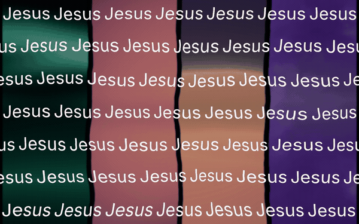
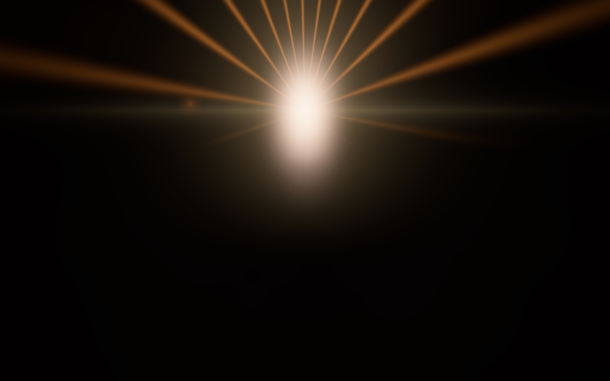
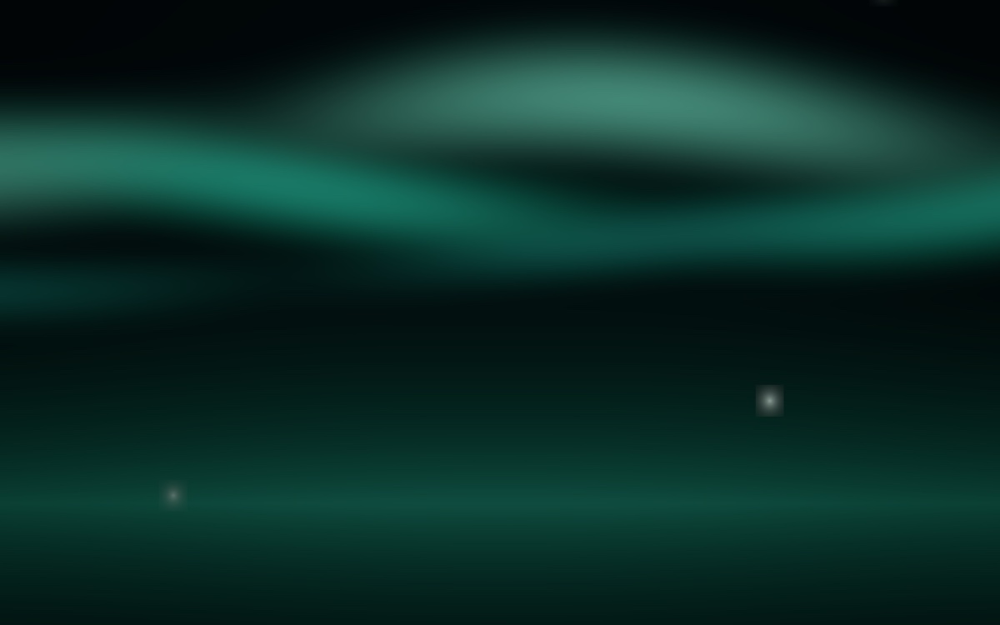
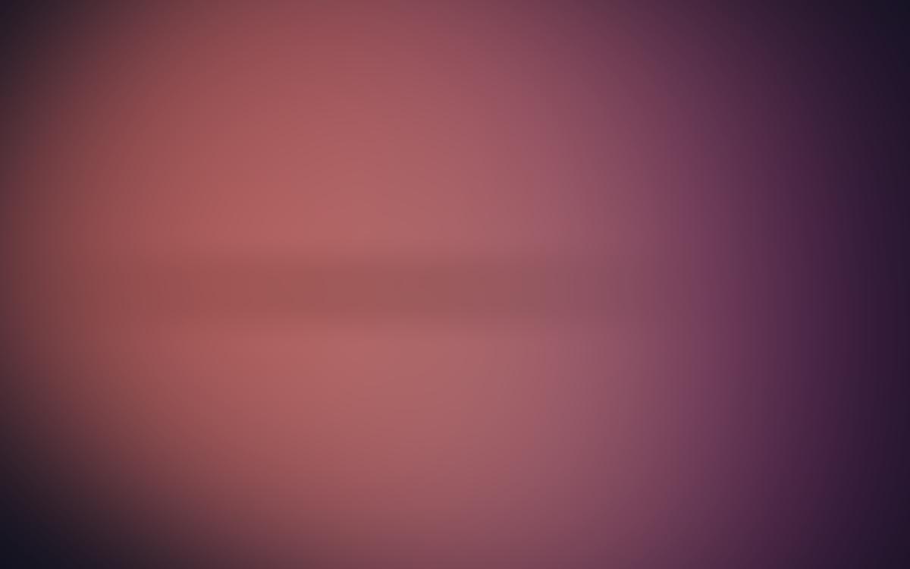
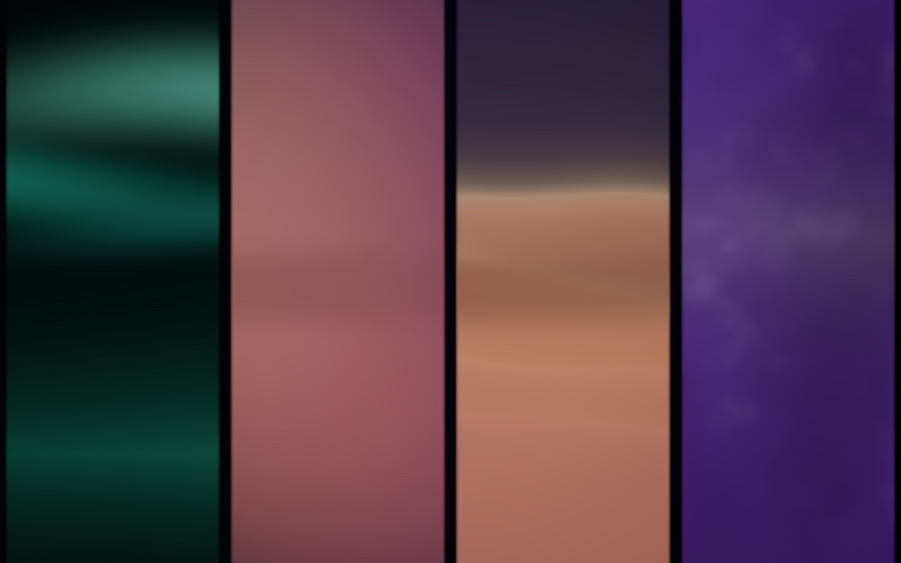
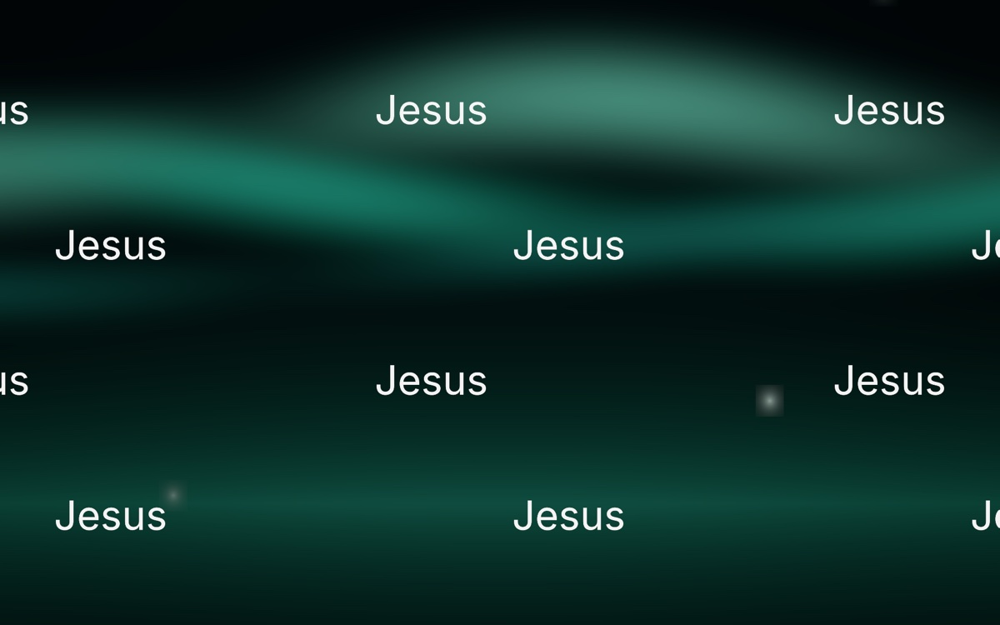
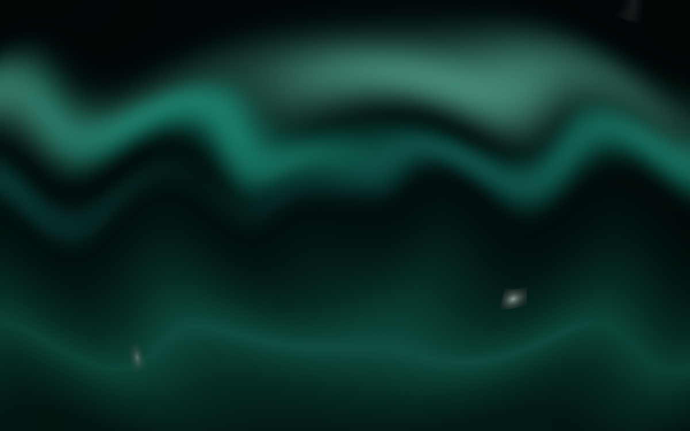

<div align="center">

<h1>BG Creator</h1>

<p><strong>Fundos procedurais para projeção de igreja — feitos em Rust, prontos para o Holyrics.</strong></p>

<p>
  <a href="https://www.rust-lang.org/"></a>
  <a href="https://wgpu.rs/"></a>
  <a href="https://egui.rs/"></a>
  <a href="https://www.holyrics.com.br/"></a>
  <a href="LICENSE"></a>
</p>



</div>

## O que é

O **BG Creator** nasceu de um problema real de igreja: os fundos de projeção sempre acabavam nos mesmos gradientes básicos. A ideia aqui é gerar, no próprio computador, fundos animados com cara de pack profissional — e exportar no formato que o **Holyrics** realmente toca.

Tudo é procedural: as imagens são calculadas por shaders WGSL na GPU, não são fotos ou vídeos baixados. Você escolhe cena, paleta, barras, texto, distorção e correção de cor, e exporta PNG ou MP4.

O alvo principal é **1920×1200 (16:10)**, que é a proporção do projetor usado na igreja. Também funciona muito bem como fundo para live, telão e apresentações.

## Destaques

- 🎛️ **2 cenas**: `Shine` (raios de luz) e `Gradient` (6 estilos).
- 🎨 **18 paletas** — quentes, frias e verdes, com interpolação em OKLab.
- 🧱 **4 barras independentes** no Gradient: cada uma com estilo, paleta, defasagem e espelho próprios.
- ✍️ **Até 4 linhas de texto** com letreiro em direções opostas, fade, flutuar e pulsar.
- 🌊 **6 mapas de warp** procedurais: FBM, turbulência, Voronoi, ondas, swirl e ripple.
- 🎚️ **Correção de cor global**: exposição, brilho, contraste, saturação, temperatura, tint, gamma e nitidez.
- 📼 **Exportação pronta para Holyrics**: H.264, 1920×1200, 30 fps, 12 s, sem áudio.
- 🖥️ Interface em português, preview ao vivo e workers para não travar a UI durante o export.

## Galeria

| Shine | Gradient · Aurora |
|:---:|:---:|
|  |  |
| **Gradient · Mesh** | **4 barras com shaders defasados** |
|  |  |
| **Texto em letreiro** | **Warp global** |
|  |  |

## Como rodar

### Requisitos

- macOS com Metal (foi desenvolvido e testado em Apple Silicon).
- Rust **1.99+** com edition 2024.
- [`ffmpeg`](https://ffmpeg.org/) para exportar MP4.

```bash
git clone https://github.com/SEU-USUARIO/bgcreator.git
cd bgcreator
brew install ffmpeg

cargo run
```

Na primeira execução o app cria `presets/shine.toml` e `presets/gradient.toml`.

## Como usar

1. Escolha a **cena**, o **estilo** e a **paleta**.
2. Ative **Barras (4)** para dividir o Gradient em quatro faixas independentes.
3. Ative **Texto** e escreva as linhas. Ex.: quatro linhas “Jesus”, alternando direita/esquerda.
4. Ative **Warp global** e escolha um mapa de ruído.
5. Ajuste a **Correção de cor** e exporte **PNG** (frame atual) ou **MP4** (loop de 12 s).
6. Importe o MP4 no Holyrics.

Os arquivos saem em `exports/` e nunca sobrescrevem: se já existir, o app cria `-2`, `-3`, etc.

## Holyrics

Importação manual:

1. Abra o Holyrics.
2. Vá em **Tema → Plano de Fundo**.
3. Adicione o vídeo exportado.
4. Ative o **loop** no tema.
5. Use o vídeo na tela pública.

O vídeo de fundo toca só na tela principal por padrão, por desempenho.

### Especificação do MP4

| Item | Valor |
|---|---|
| Codec | H.264 High |
| Resolução | 1920×1200 (16:10) |
| Frame rate | 30 fps |
| Duração | 12 s (loop sem emenda) |
| Pixel format | yuv420p |
| Bitrate | ~1 Mbps (teto de 5 Mbps) |
| Áudio | Nenhum |
| Cor | BT.709 |
| Level | 5.0 |

**Por que Level 5.0?** 1920×1200 tem 9000 macroblocks (120×75), acima do limite do Level 4.x. O nível 5.0 é o correto para essa resolução; o VLC embutido no Holyrics toca normalmente.

## Stack

| Camada | Tecnologia |
|---|---|
| Linguagem | Rust 2024 |
| Janela/UI | `eframe` + `egui` 0.37 |
| GPU | `wgpu` 30 + WGSL |
| Texto | `fontdue` + fonte Inter embutida (OFL) |
| Vídeo | `ffmpeg` via `libx264` |
| Presets | TOML + `serde` |

### Pipeline

```text
Preset (TOML)
     │
     ▼
scene pass  ── Shine ou Gradient + barras + paletas
     │  scene_texture
     ▼
post pass   ── texto + warp + correção de cor + dither
     │  final texture
     ├── preview no egui
     └── PNG / frames RGBA → ffmpeg → MP4
```

O texto é rasterizado uma vez em um atlas `2048×256×4` e vira textura. O warp e a correção de cor são aplicados depois, então afetam cena, barras e texto juntos.

### Estrutura

```text
src/
  app.rs        UI, preview, controles, export
  model.rs      Preset, paletas, barras, texto, warp, cor
  render/       pipelines wgpu, passes, readback, PNG
  text.rs       rasterização do texto (fontdue)
  encode/       PNG e worker ffmpeg
shaders/
  common.wgsl   uniforms, ruído, cor, paletas, máscaras
  shine.wgsl    cena de raios
  gradient.wgsl 6 estilos de gradiente + barras
  post.wgsl     texto, warp, correção de cor, dither
presets/        presets por cena
assets/         fonte Inter + licença OFL
docs/           imagens do README
```

## Comandos

```bash
cargo run                 # abre o app
cargo test                # testes rápidos
cargo test -- --ignored   # testes de GPU + ffmpeg (gera imagens/vídeos em target/)
cargo fmt --all
cargo clippy
```

Os testes de GPU/ffmpeg geram amostras em `target/` — úteis para comparar mudanças visuais.

## Limitações atuais

- O texto é **assado no vídeo**. Não é texto ao vivo; para letras e contagem em tempo real, use o Holyrics.
- Barras existem **somente no Gradient**. `Shine` ainda não tem modo barras.
- Saída fixa em **1920×1200**. 4K e 21:9 ficam para depois.
- Warp usa **mapas procedurais**. Ainda não importa um PNG de ruído.
- Não gera nem importa `.thf`; a importação no Holyrics é manual.
- Não há editor de keyframes: os movimentos de texto são presets.

## Roadmap

- [ ] Cena **Arc Lines**.
- [ ] Exportação de **packs** (várias seeds/paletas de uma vez).
- [ ] Cena de cruz + luz.
- [ ] Mapa de ruído personalizado por imagem.
- [ ] Mais presets de movimento de texto.
- [ ] Suporte a 1080p/4K/21:9.

## Licença

Código sob **MIT** — veja [LICENSE](LICENSE).

A fonte **Inter** está em `assets/Inter.ttf` sob a **SIL Open Font License**; a licença está em [`assets/Inter-OFL.txt`](assets/Inter-OFL.txt).

---

Feito para a igreja, com Rust, GPU e muita vontade de sair do gradiente básico. ✨
